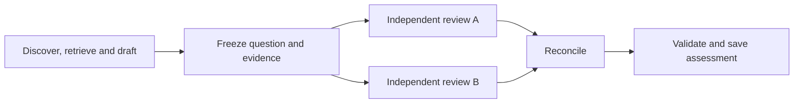

# Agentic historical research engine

Design, 11 October 2026. This is the authoritative design for `aghist`. Author-selected requirements and implementation choices are recorded below; remaining proposals are labeled. The first topic is maintained independently in [aghist-tech-adoption](../aghist-tech-adoption/README.md).

## Purpose and repository boundaries

Build a reusable agentic tool for investigating general historical causal claims, initially by explaining **when and how** they hold. The basic research unit is a historical case. Each evaluation applies a specific version of a research question to a particular revision of that case and its evidence.

- **aghist** owns Python software, pytest tests, agent instructions and this design. It accepts a library path rather than containing a particular topic's cases or source rules.
- **A topic library** owns its research purpose, question versions, case folders, source records, assessments, synthesis and any associated manuscript. The first library is `~/src/aghist-tech-adoption`.
- The existing public site continues to own approved publication copies and site implementation. Large archival originals may remain at the exact external paths recorded by a library.

The engine and library are separate local Git repositories. The engine must be usable with another topic by supplying that topic's question and source guidance, without changing its workflow code. Topic-specific definitions belong in the library rather than the engine's prompts or schemas.

## Settled requirements

1. Use a team of agents for ongoing discovery, source inspection, evaluation and refinement.
2. Treat a historical case as the basic unit; save each case in its own descriptive folder.
3. Record exactly which research-question versions each case has been assessed against. Preserve useful iterations and variants of the question.
4. Have more than one agent evaluate each case. The proposed minimum is two independent evaluations, beyond preparing the case.
5. Use empirical cases collectively to improve definitions, identify recurring outcomes and mechanisms, and propose more precise questions.
6. Collect and investigate invalidating cases as seriously as supporting ones. Preserve mixed and unresolved evidence.
7. Reassess cases after substantive changes to a question or its definitions, and after relevant evidence changes.
8. Use files and folders as durable research memory wherever this avoids a separate maintained index.
9. Implement in Python, use **pytest**, and use **Google-style docstrings for non-trivial functions, classes and other objects**.
10. Keep the first implementation minimal and robust. Build one working research loop before adding optional infrastructure or conveniences.
11. Include web discovery and source retrieval in the first working workflow.
12. Run agents through the author's OpenCode subscription and available OpenCode tooling. Start with the latest DeepSeek Flash offered there.
13. Agents may create and test working question versions; the author chooses the principal version.
14. Existing topic research may be reorganized or used as input for newly prepared cases. Its inherited file layout and case template do not constrain the reusable engine. Preserve evidence, provenance and the scope of earlier judgments.

## Methodological approach

The agreed initial target is **contingent generalization**: causal explanations whose mechanisms and applicability depend on historical circumstances. This is a kind of inference to pursue, not a complete research method by itself.

The author's earlier inspiration from Brenner's Center for Social Theory and Comparative History suggests a broader comparative-historical orientation. UCLA describes the center as connecting historically rooted social theory with theoretically informed comparative history. That institutional aim supports the orientation; it does not prescribe a single method or commit this project to a particular substantive theory. [UCLA's description](https://socialsciences.ucla.edu/research-centers/).

Several approaches can work together:

| Approach | Use in this program |
| --- | --- |
| Comparative-historical analysis | Compare similar and contrasting historical settings, practices and sequences to develop and challenge explanations. The comparative sequential method explicitly connects comparison across cases with analysis within them. |
| Process tracing | Examine the sequence and diagnostic evidence within a case to assess a proposed mechanism and alternatives. |
| Abductive refinement | Use surprising cases and mismatches between expectations and evidence to propose better concepts, questions or explanations. |
| Typological theorizing | Group cases by combinations of conditions and mechanisms, developing bounded explanations rather than forcing one generalization across all settings. |
| Qualitative Comparative Analysis (QCA) | A possible later method for comparing combinations of conditions once the case set and coding rules warrant it. Formal set membership and calibration would be additional research decisions; QCA is outside the first implementation. |

Recommended starting practice: comparative historical cases, within-case mechanism assessment and explicit proposals for empirical refinement. These are intellectual practices supported by the same simple case-review workflow, not separate software modes.

Sources inspected: Falleti and Mahoney, [“The comparative sequential method”](https://www.cambridge.org/core/books/abs/advances-in-comparativehistorical-analysis/comparative-sequential-method/4EA22A74E138226321803CDBDE27618E), *Advances in Comparative-Historical Analysis* (2015), publisher summary; Collier, [“Understanding Process Tracing”](https://www.cambridge.org/core/journals/ps-political-science-and-politics/article/understanding-process-tracing/183A057AD6A36783E678CB37440346D1), *PS* 44(4) (2011), online abstract and opening discussion; Bennett, [“Drawing Contingent Generalizations from Case Studies”](https://www.cambridge.org/core/books/case-for-case-studies/drawing-contingent-generalizations-from-case-studies/58F73BA16250FECBE4D7EE8F5F02943E), *The Case for Case Studies* (2022), online chapter; Tavory and Timmermans, [*Abductive Analysis*](https://press.uchicago.edu/ucp/books/book/chicago/A/bo18785947.html) (2014), publisher description, not the full book; Ragin's [QCA introduction](https://sites.socsci.uci.edu/~cragin/fsQCA/), inspected in full. These inform the proposed method, not evidence that the machine has been validated.

## Versioning the research question

A library keeps a stable research purpose, then one or more named questions. Each question has immutable numbered versions such as `v001`, `v002`. A version preserves the exact wording, definitions, scope, component claims or variants, assessment criteria, parent version and reason for revision. Any changed substantive text receives a new version. Git preserves ordinary editing history; a Git commit alone is insufficient as the question identifier in a case assessment.

An assessment identifies `question_id`, `question_version`, `case_id`, the case/evidence revision and the component claims it addresses. One case can be evaluated against several question versions and several components within a version. The cases assessed under a version can be found by scanning their assessment folders and fields.

A question's current record points to its adopted version and identifies any working variants. Agents may create and test useful working versions while preserving the stable purpose and the reasons for each change. The author chooses the principal version. Testing a working version does not promote it to the principal question or replace earlier assessments.

For example, “new technologies often require organizational change to utilize them well” contains separate issues: new to whom, which work changes, what benefit, whether a change is necessary or contributory, through which mechanism, and frequent among which cases. Keep those components explicit rather than silently replacing necessity with helpfulness or a particular outcome with a broader one.

## Cases, evidence and assessment

A case account describes a bounded historical episode or coherent comparison: actors, setting, sequence, practices or interventions, outcomes and uncertainties. It is separate from evaluations against particular questions. Multiple retellings of the same episode are linked rather than treated as independent observations.

Assessments explain source fidelity, relevance to the question's scope, the mechanism steps supported or unobserved, alternative explanations, invalidating evidence, and the limits of the account. A case can support one component, qualify another and remain inconclusive on a third. Favorable outcomes, causal support and source quality are separate judgments. A credible attributed account can contribute without a numerical measure or a complete causal test.

Evaluators must assess the question's actual wording. Benefits without a new work change can challenge a necessity claim, but may reveal an already suitable arrangement. Failure despite a work change bears on sufficiency and scope; it does not alone disprove necessity. Missing evidence or failed retrieval is not evidence that an event did not occur.

The selected question version and the library's explicit source guidance govern case inclusion and assessment. The engine should not impose universal demands for controlled comparisons, large effects or independent corroboration. The strength of a case's contribution to a particular generalization is a separate assessment. The inherited technology-adoption template is topic guidance, not the engine's common case schema; a generic case account must accommodate adverse outcomes, absent work changes and unresolved mechanisms.

## Minimal team workflow

Python coordinates four agent sessions per case: one researcher for discovery, retrieval and case preparation; two independent evaluators; and one curator/reconciler. The initial workflow processes one case at a time. At most two agents run concurrently, during the independent reviews. Worker agents cannot launch further agents. The concurrency limit applies across the entire run.

1. Select a bounded investigation addressing a useful uncertainty or comparison.
2. Gather sources and prepare a case account plus an evidence packet with exact provenance and locators.
3. Give two fresh evaluators the same question version and evidence revision, with prior verdicts omitted from the review packet. Neither sees the other's verdict before submitting. Both examine the full rubric, including rival explanations and invalidation.
4. Reconcile the reviews into an assessment, preserving unresolved disagreements and naming any useful follow-up. Agreement among agents is not independent historical corroboration.
5. Periodically compare reviewed cases and propose informative next investigations or question refinements.

Separate input packets and access controls should enforce review independence. A researcher summary alone does not replace accessible original evidence. Concurrent workers write separate outputs; one curator writes the accepted account and assessment. A case becomes reviewed for a version only after the required valid evaluations and reconciled assessment exist.

Collection proceeds in bounded, resumable batches with explicit call, runtime and retrieval limits and stopping rules. Use the selected subscription route; quota exhaustion leaves work resumable. A paid fallback or additional service would be a separate choice. Invalidating, adverse and mixed cases receive the same seriousness and source standards as supporting cases. Discovery routes should seek meaningful contrasts rather than only sources already endorsing the proposition. The goal is informative evidence, including evidence that weakens an explanation.

## Accepted operating defaults

The author accepted these defaults on 11 October 2026:

- A manually started batch considers up to three candidate cases, one case at a time. No suitable case is a valid result; do not fill a quota.
- A short research brief directs each batch toward a gap, mechanism or useful contrast, under an explicit question version.
- Fresh reviewers receive identical frozen evidence and no prior assessments or each other's verdicts.
- Preserve completed stages, resume unfinished work, use bounded retries and stop on subscription limits.
- Append evidence and assessment revisions; preserve earlier case accounts and judgments.
- End each batch with grounded refinement proposals. Agents may create and test working versions; the author selects the principal question.
- Use an OpenCode backend with browser access through `opencode web`; its terminal UI can attach to the same backend. Inspect sessions at any time; pause the workflow before manually steering an engine-owned session. Changed review evidence requires fresh reviews.
- Recurring scheduling follows a reliable first loop. These defaults do not start a background research campaign.

## Running for hours — proposed requirements

Longer unattended work should repeat small, checkpointed batches under a fixed campaign brief, question version and time budget. The following extends the accepted defaults and remains a design proposal:

- Persist queued work, session/message identifiers, inputs and completed outputs before moving to the next stage. After a restart, inspect already submitted work before creating another request. A lost connection alone does not justify rerunning an agent.
- Set campaign and per-agent deadlines, a retrieval bound and retry limits. Stop starting new work near the deadline; abort overlong tasks and preserve unfinished state. Quota exhaustion or repeated backend failures stops the campaign without changing provider or billing route.
- Give agents only the tools needed for their roles. Preconfigure allowed research actions and denied out-of-scope actions. An unexpected permission or user question becomes explicit work needing attention, with a timeout, rather than an indefinite wait.
- Use one writer for accepted records and a library/run lock to prevent two coordinators writing the same work. Validate question/evidence references and both independent reviews before a case is marked reviewed. Question refinements remain working versions until the author selects a principal version.
- At batch boundaries, use remaining gaps and contrasts in the brief to choose the next investigation. Record duplicate episodes and sources, retrieval failures and empty results. Stop after repeated batches with no informative progress rather than widening the question merely to keep collecting.
- Keep a compact current run record with active stage, elapsed time, completed assessments, failures, stopping reason and exact continuation. Keep final research findings in their case/question records. OpenCode sessions support inspection but do not replace durable library records.

A conservative first unattended trial could allow four hours, keep the two-agent concurrency cap and three-case batches, allow ten minutes per agent task, and stop after two successive batches producing only duplicates or inaccessible leads. Numeric limits should be tuned after the first live batch. The host must remain awake with the coordinator alive; resumption should tolerate interruption. Additional process supervision and scheduling are later operational choices.

Sources checked 11 October 2026: OpenCode [server lifecycle and sessions](https://opencode.ai/docs/server/), [permissions](https://opencode.ai/docs/permissions/) and [subscription limits](https://opencode.ai/docs/go/). These document available mechanisms; they do not establish that an hours-long research run has been tested.

## Empirical refinement and protection against drift

Refining the question is part of the agents' research work. In the technology example, the cases may reveal recurring senses of “utilize well”: lower downtime, improved quality, reduced material use, or easier coordination. Agents should propose distinctions grounded in identifiable cases rather than require all outcomes to fit a fixed vocabulary in advance.

Aggregate descriptions may identify a more specific and more frequent variant **within the collected, reviewed cases**. Record the category definition, missing information and the cases it includes. Frequencies in a selectively assembled collection do not establish prevalence across all historical adoptions. The initial priority remains when and how; population frequency estimation is deferred.

Each refinement proposal gives old and new wording, motivating cases, changed definitions or scope, effects on previous judgments, contrary cases and the next inquiry that could challenge it. Preserve useful alternative versions rather than forcing one formulation prematurely. A narrower scope requires a substantive explanation; a higher proportion of supportive cases is insufficient justification.

The author's purpose anchors the inquiry. A different outcome, population or purpose should be identified as a different branch. Cases used to develop a version are identified as development evidence; additional comparisons can then examine it. Reassess affected cases, including formerly excluded cases, when a substantive version changes. Keep old assessments and distinguish current, outdated and unreviewed work in synthesis.

## Library layout

```text
README.md
notes.md
questions/
  technology-and-work/
    question.md
    versions/v001.md
cases/
  electric-motors-and-factory-layout/
    case.md
    sources/
    assessments/
      technology-and-work/
        v001/
          review-a.md
          review-b.md
          assessment.md
supporting/
article/
```

This illustrates the first library, not mandatory technology-specific engine fields. A question version can also be marked as a working proposal. Exact record serialization is an implementation choice; stable identifiers, version references and evidence revisions are required. A new assessment of changed evidence goes in a distinct assessment revision or run folder; it never overwrites earlier reviews.

Folders retain descriptive names regardless of classification. A folder scan finds cases, assessments and pending reassessment; a separate maintained case index is unnecessary. Any later search index must be rebuildable from authoritative files. Shared source originals can stay outside case folders with precise references. A small amount of operational state records attempts, expenditure and running work; it must not become a second catalogue of research knowledge.

The initial library preserves earlier case verdicts and their original scope. Moving a record into a case folder or creating the first question version does not turn those verdicts into completed evaluations under the new engine.

## Using existing research

The author permits reorganizing the technology-adoption library to fit aghist. The engine therefore needs no compatibility layer for its earlier case format. Existing accounts, source records and assessments remain research material with their original provenance and scope. Reformatting a case does not validate it, and earlier verdicts do not become new independent reviews.

**Proposed first-library approach:** use a few existing dossiers as inputs to the ordinary researcher stage, alongside fresh discovery. The researcher prepares a bounded historical account and an evidence packet; the two reviewers and curator then use the same workflow as for a newly discovered case. Preserve a reference to the inherited dossier and to the underlying sources actually used. Distinguish newly inspected evidence from checks reported in earlier notes, and carry forward access limits. A prior AI-generated summary can supply leads and pointers to attributed historical accounts, but it does not become another historical source corroborating the publications it summarizes.

The review packet omits earlier eligibility labels, rankings and verdicts. It retains substantive evidence, contradictions and source qualifications. The curator may compare old and new assessments after both independent reviews are saved. Several inherited notes may describe one episode; one note may contain several episodes. Prepare cases around historical boundaries rather than assuming one new case per old file.

Choose the generic case and assessment formats by trying a small set of contrasting cases before any bulk reorganization. Preserve earlier records as source material rather than replacing them with new accounts. Exact folder changes remain an implementation choice. A file reorganization or narrative-template change alone does not change the research question; changed definitions, scope or assessment criteria require a new question version. The adopted v001 stays intact.

## Architecture review — accepted implementation decisions

**Status:** Accepted, with hashing narrowed to one checksum per frozen review packet. **Date:** 11 October 2026. **Decider:** the author. The agreed requirements, two-agent concurrency cap and independent topic library remain in force. These decisions do not themselves resume implementation or start a live campaign.

### Context and recommendation

The research scope is coherent. The main unresolved risks are the handoff from retrieved evidence to case interpretation, ambient context leaking into reviews, and retrying a remote operation whose outcome is unknown. Reliability comes from explicit inputs, validated artifacts and bounded recovery. A general agent-management framework would add little to the first workflow.

Recommend one Python workflow with a small OpenCode HTTP adapter and a file store. A longer campaign repeatedly calls that same workflow under a deadline and bounded brief. Use role instructions and fresh sessions rather than separate software agents with their own planners, queues and persistence. Python owns identifiers, state transitions and accepted writes.



### Options and trade-offs

| Choice | Recommendation and consequence |
| --- | --- |
| OpenCode HTTP versus a CLI process per job | Keep the documented HTTP interface. CLI calls are attractive for a throwaway script, but inspection, cancellation and recovery already require a persistent server and session identifiers. Use one small adapter and simple polling; the UI can use the same server. |
| Automatic server management versus connecting to a running backend | Initially connect to a separately started local OpenCode backend and check its health/version. This removes process ownership and automatic restart behavior from the engine. A one-command launcher can follow if startup proves inconvenient. |
| Curator per case versus conditional or batch-only reconciliation | Keep per-case reconciliation initially, preserving both raw reviews and their disagreements. It gives a simple completion contract. Conditional reconciliation saves calls but requires deciding whether apparently similar reviews truly agree; batch-only reconciliation couples otherwise independent case completion. Reuse the curator role for batch refinement. |
| A second campaign engine versus repetition of the batch workflow | Use the same workflow for one batch and an hours-long campaign. Only the outer deadline, queue and stopping reason change. |
| Semantic stagnation scoring versus explicit work limits | Make deadlines, attempt limits, duplicates and retrieval outcomes enforceable. Treat a curator's judgment about diminishing research value as advice initially. Do not add another model-driven controller to decide whether useful progress has occurred. |

### Record and evidence contracts

- A job saves one frozen review packet containing the exact question text, case account and selected source evidence supplied to both reviewers. Use readable question versions and case/evidence revision IDs for naming and navigation. Record one SHA-256 checksum of the packet's saved bytes and check it before reusing a review after interruption and before accepting completion. Include the evidence text itself, not only paths to mutable files. A changed packet requires a new assessment revision and fresh reviews. Keep generated reviews and logs outside the packet. This is a small guard against mixing revisions, not a content-addressed store or a separate per-file hashing system.
- Save actual search/retrieval outputs from OpenCode, including failures and truncation/access limits. Give reviewers the retrieved evidence as well as the neutral case account. A researcher-generated source list or paraphrase alone is insufficient. A fetched page is evidence of retrieval, not a mechanical proof of the researcher's causal interpretation.
- Use a few small structured output contracts for case preparation, review and reconciliation. Python adds authoritative IDs, evidence references and execution metadata, rather than trusting model-echoed identifiers. Keep analytical explanations in prose; schema validity does not establish historical validity.
- Keep workflow completion separate from research conclusions. Two complete reviews can conclude that a case is mixed, irrelevant, unresolved or invalidating. Preserve those conclusions without treating them as execution errors or rewarding supporting cases.
- Use Markdown for human accounts and interpretations, a small JSON run record for operational state, and immutable attempt outputs. Save atomically and create an explicit completion receipt referencing the accepted inputs and two reviews. File existence alone does not establish completion. A local advisory lock prevents concurrent coordinators writing one library.

### Independence and recovery

Fresh session IDs are necessary but insufficient if reviewers can read prior verdicts through files, shared instructions, tools or inherited context. Prefer reviewer requests containing only the frozen packet, with tool access limited to that packet; disable delegation and unrelated tools. If more evidence is needed, make a new packet and evaluate both reviewers against it. Treat source text as evidence rather than operational instructions.

Use the OpenCode UI for inspection and separate sessions for manual exploration. Manual changes to an engine-owned review invalidate that attempt; pausing does not itself preserve independence after new instructions or evidence are introduced.

Persist session and message identifiers before submitting a job. After an ambiguous network failure, inspect that job's status/messages before another submission. A client-supplied message ID must not be assumed to guarantee provider idempotency; verify the installed server's behavior. If completion cannot be established, retain an explicit unresolved attempt and stop rather than silently duplicate it. Bound validation retries, tool steps where supported and per-task runtime; inspect late results before accepting a retry.

Keep question refinement at batch boundaries. Agents may create and test working versions as agreed, but testing uses an explicitly selected version and recorded development cases. A new version marks affected prior assessments stale; it should not automatically enqueue the entire corpus. Start with selected reassessments and retain previous conclusions. Preserve candidate duplicate links rather than automatically merging historical episodes by title or shared URL.

### Verification and consequences

Before building the complete workflow, perform a small integration check of the installed OpenCode version: subscription model selection, observed web search/retrieval outputs, structured results, session isolation and cancellation. Documentation establishes available mechanisms, not that this exact combination has worked. Pin the chosen route and record runtime versions for each run.

Prioritize pytest checks for a crash after remote completion but before the local checkpoint, a partial output write, two coordinators, a changed question/evidence packet, a missing or malformed second review, repeated failures, and timeout/permission/quota stops. Inspect a small live batch against the retained sources before an hours-long campaign. These checks are more useful than broad counts of test coverage.

The resulting core needs a workflow, an OpenCode adapter, file persistence/validation and a CLI. These are responsibility boundaries, not a requirement for four classes or a plugin interface. Search indexes, distributed queues, automatic server restarts, corpus-wide reassessment scheduling and additional model providers can wait until observed work justifies them.

References checked 11 October 2026: OpenCode [server](https://opencode.ai/docs/server/), [structured output](https://opencode.ai/docs/sdk/#structured-output), [permissions](https://opencode.ai/docs/permissions/) and [agents](https://opencode.ai/docs/agents/). The installed server contract still needs an integration check.

## First implementation and verification

Python coordinates the workflow; OpenCode runs the agents through the author's existing subscription. The first working loop includes web discovery, source retrieval, case preparation, two independent evaluations and a reconciled assessment saved to a library. It must resume interrupted work without discarding valid earlier outputs. Start with one provider and the tools needed for this loop.

Use the documented local server interface from Python; the accepted `opencode web` backend exposes it together with the browser UI. Give each researcher or evaluator a distinct session; fresh reviewer sessions receive their own evidence packets and cannot see each other's reviews. OpenCode supplies agent execution, model access and tools; Python owns question references, record validation, workflow state and accepted file writes. Its CLI remains useful for inspection and manual work; a separate JavaScript application is unnecessary.

Use OpenCode's available `websearch` and `webfetch` tools for discovery and page retrieval before adding another search service. Retain returned evidence with its URL, retrieval time, bibliographic identity, useful locators and actual inspection limits. Search results alone do not validate a case. A converted page or extracted text must not be described as a preserved original PDF. Source storage follows the selected library's instructions.

The selected initial model route is **`opencode-go/deepseek-v4.1-flash`**, confirmed in the installed OpenCode 1.18.35 model list on 11 October 2026; the Go connection was listed as configured. This verifies local configuration, not a successful live inference or current quota. DeepSeek's current Flash release is V4.1, and OpenCode's Go documentation lists that release under `deepseek-v4.1-flash`. Resolve the latest supported Flash at the start of a batch and record the exact provider/model, reported model information, OpenCode version and date in its outputs; keep the choice fixed within a batch.

References: OpenCode [server](https://opencode.ai/docs/server/), [CLI](https://opencode.ai/docs/cli/), [tools](https://opencode.ai/docs/tools/) and [Go models and usage limits](https://opencode.ai/docs/go/), plus DeepSeek's [current model details](https://api-docs.deepseek.com/quick_start/pricing/), checked 11 October 2026. The first implementation should check the installed server's schema instead of assuming every current documentation example matches it. Use bounded batches and stop on subscription quota or runtime limits rather than silently changing the billing route.

Use pytest for meaningful checks of version immutability, references to the intended case/question/evidence revision, completion requiring two evaluations, preservation of earlier assessments, stale-review detection, and resumption after interruption. Model failures and invalid outputs must leave work explicitly unfinished. Use temporary libraries and a deterministic fake worker for offline tests; separately inspect a few real outputs before trusting a live run. Python correctness tests do not establish historical validity.

Use Google-style docstrings for non-trivial objects, explaining behavior, arguments, returns and exceptions where useful. Prefer straightforward functions and a small number of modules. No dashboard, database, search index, plugin framework or multi-provider framework is needed for the first working loop. Add capabilities only when the basic workflow exposes a concrete need.

## First build target

Implement one bounded, manually started batch that discovers and retrieves evidence, prepares a historical case, obtains two independent reviews and saves the assessment against an explicit question and evidence revision. Include working question versions that agents can test without changing the author-selected principal version. Exercise failure and resumption using pytest and fake workers before checking a small live batch through OpenCode.

The author has settled question authority, discovery from the beginning, Python, OpenCode subscription access and the initial model family. The main architecture and the smaller implementation with explicit record/recovery contracts above are accepted. Numeric batch limits are conservative implementation defaults that can be adjusted after observing actual work. Continuous scheduling and broader tooling come after the basic loop works.
